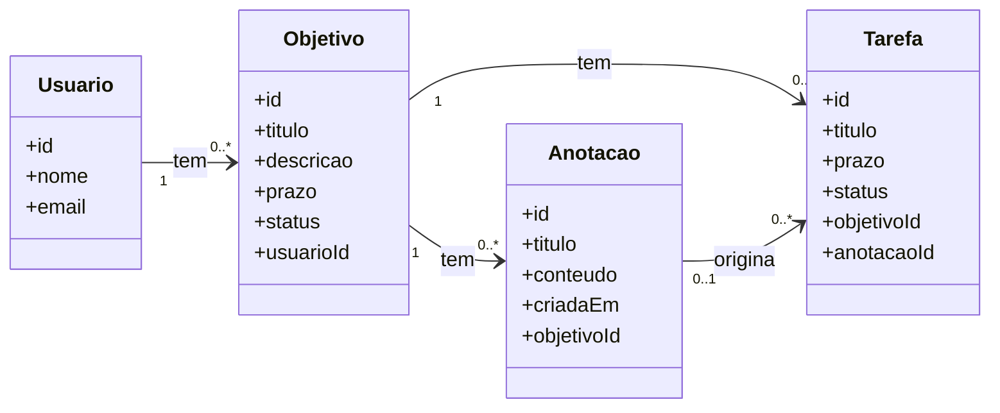
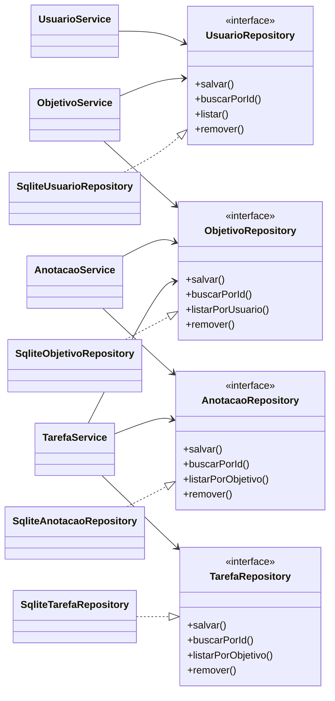

# Modelagem: Trilha de Estudos

**Aluno:** Nicolas Pereira de Souza

## Domínio

Sistema para qualquer pessoa que queira estudar algo, seja para a faculdade, um concurso, um idioma ou um hobby. O usuário cria **objetivos** de aprendizado (por exemplo, "aprender SQL") e, dentro de cada um, registra anotações do que está estudando e tarefas para chegar lá. Uma tarefa pode ser ligada a uma anotação que a originou (por exemplo, "revisar este resumo").

## Entidades

### Usuario
- `id`: identificador
- `nome`: texto
- `email`: texto
- Relacionamento: **1 usuário tem N objetivos**

### Objetivo
- `id`: identificador
- `titulo`: texto (ex.: "Aprender SQL")
- `descricao`: texto
- `prazo`: data (opcional)
- `status`: `EM_ANDAMENTO` ou `CONCLUIDO`
- `usuarioId`: referência ao usuário
- Relacionamentos: pertence a 1 usuário; **1 objetivo tem N anotações e N tarefas**

### Anotacao
- `id`: identificador
- `titulo`: texto
- `conteudo`: texto
- `criadaEm`: data
- `objetivoId`: referência ao objetivo
- Relacionamentos: pertence a 1 objetivo; pode originar 0..N tarefas

### Tarefa
- `id`: identificador
- `titulo`: texto
- `prazo`: data
- `status`: `PENDENTE` ou `CONCLUIDA`
- `objetivoId`: referência ao objetivo
- `anotacaoId`: referência opcional à anotação
- Relacionamentos: pertence a 1 objetivo; pode estar ligada a 0..1 anotação

## Diagrama de classes

### Entidades e relacionamentos

### Camadas: services dependem de repositories (DIP)

As setas dos services terminam sempre nas interfaces de repository. Nenhum service aponta para o banco.

## Responsabilidades

| Entidade | Service (regra) | Repository (dados) |
|---|---|---|
| Usuario | `UsuarioService`: valida nome e e-mail e impede e-mail duplicado | `UsuarioRepository`: salvar, buscar, listar, remover |
| Objetivo | `ObjetivoService`: confirma que o usuário existe, exige título e controla a conclusão do objetivo | `ObjetivoRepository`: CRUD e listagem por usuário |
| Anotacao | `AnotacaoService`: exige título e objetivo existente e define a data de criação | `AnotacaoRepository`: CRUD e listagem por objetivo |
| Tarefa | `TarefaService`: valida o prazo, controla a mudança de status e confirma o objetivo e a anotação (se houver) | `TarefaRepository`: CRUD e listagem por objetivo |

## SRP e DIP

**SRP:** as entidades só carregam dados: não se salvam nem enviam e-mail. Cada service cuida apenas das regras de uma entidade (validar, conferir existência, mudar status) e cada repository cuida apenas de guardar e buscar. Se a regra de prazo mudar, só o `TarefaService` muda; se a forma de armazenar mudar, só o repository muda.

**DIP:** os services dependem das interfaces `*Repository`, nunca de uma implementação concreta nem do banco. O SQLite fica nas classes `Sqlite*Repository`, que implementam essas interfaces e são injetadas nos services. Assim, dá para trocar o armazenamento (ou usar uma versão em memória nos testes) sem alterar nenhuma regra de negócio.